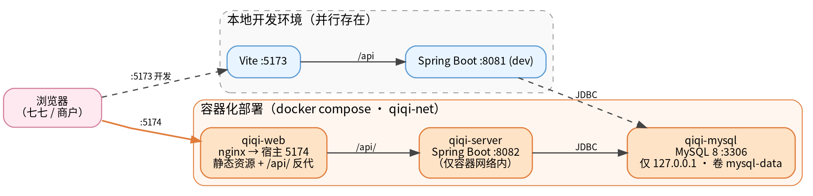
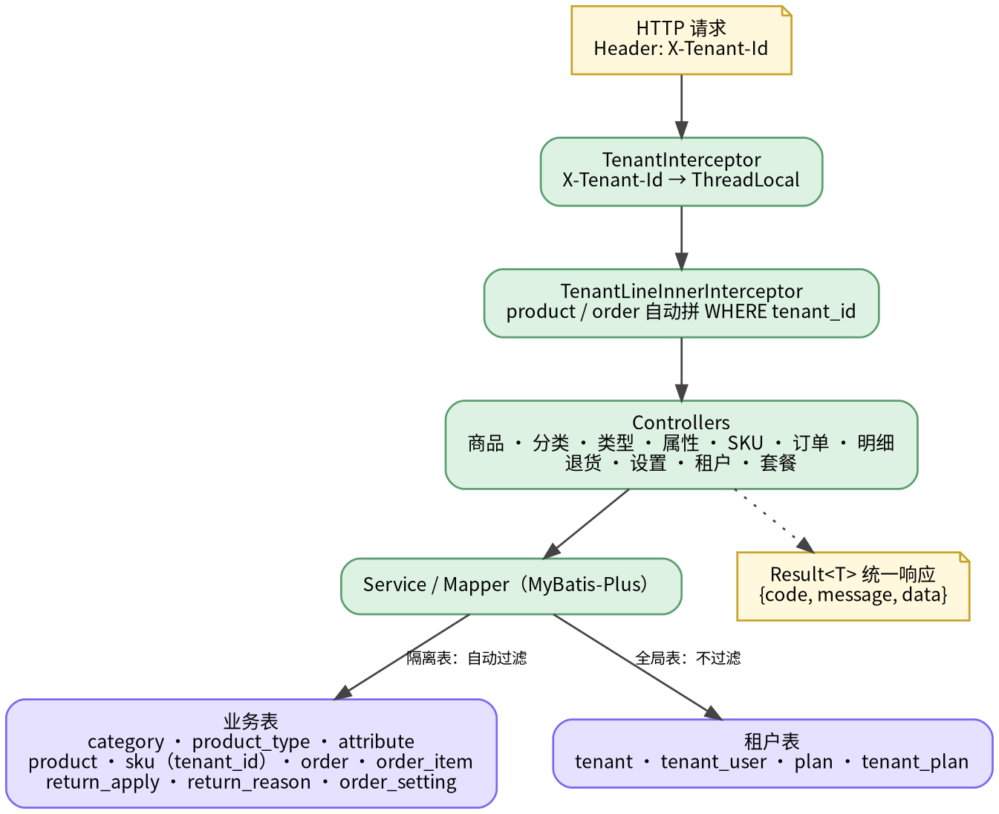

# 七七商城 系统架构

> 源文件：`docs/architecture.dot`（部署拓扑）+ `docs/request-flow.dot`（请求/租户隔离流程）
> 重新出图：`dot -Tpng -Gdpi=150 docs/xxx.dot -o docs/xxx.png`（graphviz）

## 1. 部署拓扑



## 2. 请求处理与租户隔离



## 历史版本

以下 mermaid 版本保留作参考（单图塞下所有信息导致布局混乱，已弃用）：

# 七七商城 系统架构图

```mermaid
flowchart TB
    subgraph clients["客户端"]
        USER["浏览器<br/>(七七 / 商户)"]
    end

    subgraph dev["本地开发环境"]
        VITE["Vite Dev Server<br/>:5173<br/>(HMR 热更新)"]
        SBDEV["Spring Boot dev<br/>:8081<br/>(devtools 热重启)"]
    end

    subgraph deploy["容器化部署 (docker compose / qiqi-net)"]
        subgraph web_container["qiqi-web (nginx:alpine)"]
            NGINX["nginx<br/>:80 → 宿主机 5174<br/>静态资源 + /api/ 反代"]
        end
        subgraph server_container["qiqi-server (temurin-21-jre)"]
            SPRING["Spring Boot 3.3.5<br/>:8082 (仅 expose)<br/>profile=prod"]
        end
        subgraph mysql_container["qiqi-mysql (mysql:8.4)"]
            MYSQL["MySQL 8<br/>:3306 → 127.0.0.1<br/>数据卷 mysql-data"]
        end
    end

    subgraph backend_modules["后端模块 (Spring Boot)"]
        direction TB
        INTERCEPTOR["TenantInterceptor<br/>解析 X-Tenant-Id → ThreadLocal"]
        TENANT_PLUGIN["MyBatis-Plus<br/>TenantLineInnerInterceptor<br/>(product/order 自动 WHERE tenant_id)"]
        CONTROLLERS["Controllers<br/>商品/分类/类型/属性/SKU<br/>订单/明细/退货/设置<br/>租户/套餐"]
        SERVICES["Service 层<br/>MyBatis-Plus IService"]
    end

    subgraph db_schema["MySQL: qiqi_mall"]
        direction LR
        subgraph 业务表["业务表"]
            T1["category / product_type / attribute"]
            T2["product / sku (含 tenant_id)"]
            T3["`order` / order_item"]
            T4["return_apply / return_reason / order_setting"]
        end
        subgraph 租户表["租户表"]
            T5["tenant / tenant_user"]
            T6["plan / tenant_plan"]
        end
    end

    subgraph repo["GitHub 仓库 zzy-repo/qiqi-mall"]
        GIT["main 分支"]
    end

    USER -->|"http://100.113.135.55:5174"| NGINX
    USER -->|"开发 http://...:5173"| VITE
    NGINX -->|"/api/ proxy_pass"| SPRING
    VITE -->|"proxy /api → 8081"| SBDEV
    SPRING --> INTERCEPTOR --> TENANT_PLUGIN --> CONTROLLERS --> SERVICES
    SBDEV --> INTERCEPTOR
    SERVICES -->|"JDBC"| MYSQL
    MYSQL --- db_schema
    GIT -.->|"镜像构建"| deploy
```

## 说明

| 层 | 内容 |
|---|---|
| 客户端 | 浏览器访问宿主机 5174（部署）或 5173（开发） |
| 部署栈 | 三容器：web(nginx 5174→80) / server(8082 仅内部) / mysql(3306 仅绑 127.0.0.1)；只有 web 暴露公网 |
| 开发栈 | Vite 5173 + Spring Boot 8081，与部署栈共存 |
| 租户隔离 | 拦截器读 `X-Tenant-Id` → ThreadLocal → SQL 自动拼 `tenant_id` |
| 数据库 | 10 张业务表 + 4 张租户表，utf8mb4/InnoDB |
| 代码流 | GitHub main → docker compose build 镜像 |
