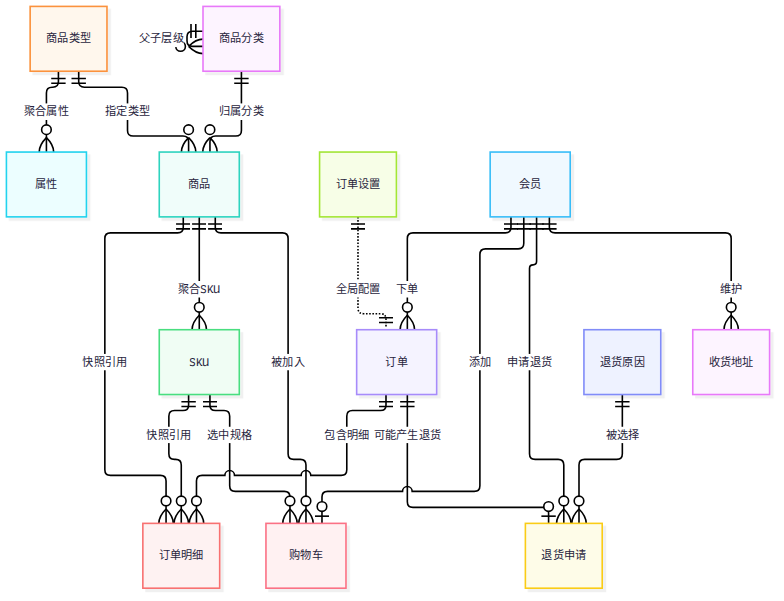
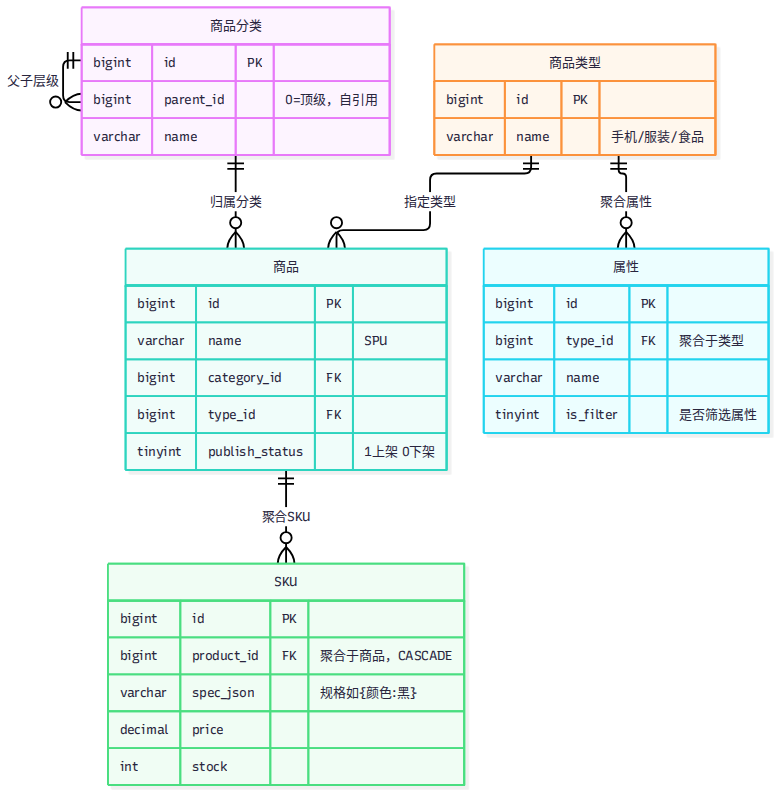
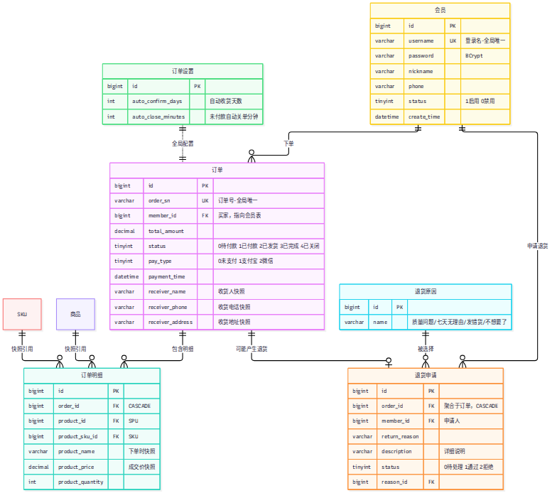
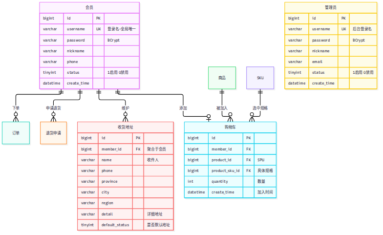

# 七七商城 ER 图

> Mermaid 源码在 `docs/er/*-full.mmd`，对应图片为同目录 `*-full.png`。
> 重新出图：`npx --prefix /tmp/mmdc mmdc -p /tmp/mmdc/puppeteer.json -i docs/er/xxx.mmd -o docs/er/xxx.png -b white`

## 总览（三模块 14 张表的关系）

## 商品模块

`category` 商品分类（自关联树）· `product_type` 商品类型 · `attribute` 属性 · `product` 商品SPU · `sku` SKU

## 订单模块

`order` 订单 · `order_item` 订单明细 · `return_apply` 退货申请 · `return_reason` 退货原因 · `order_setting` 订单设置

## 用户模块

`member` 会员 · `member_address` 收货地址 · `cart` 购物车 · `admin` 管理员

