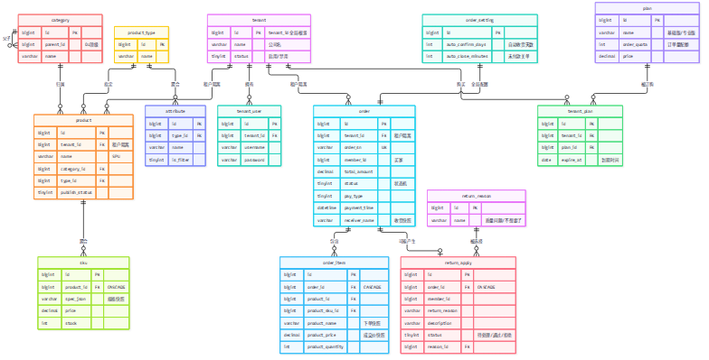
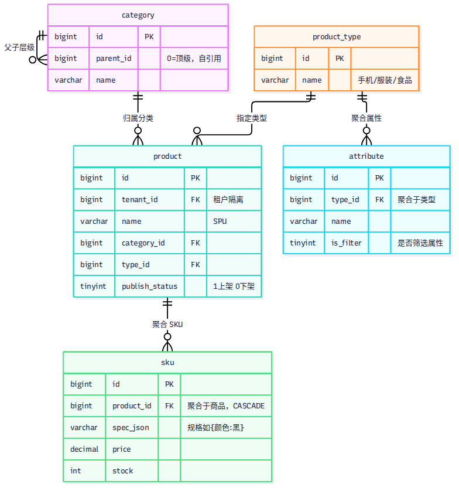
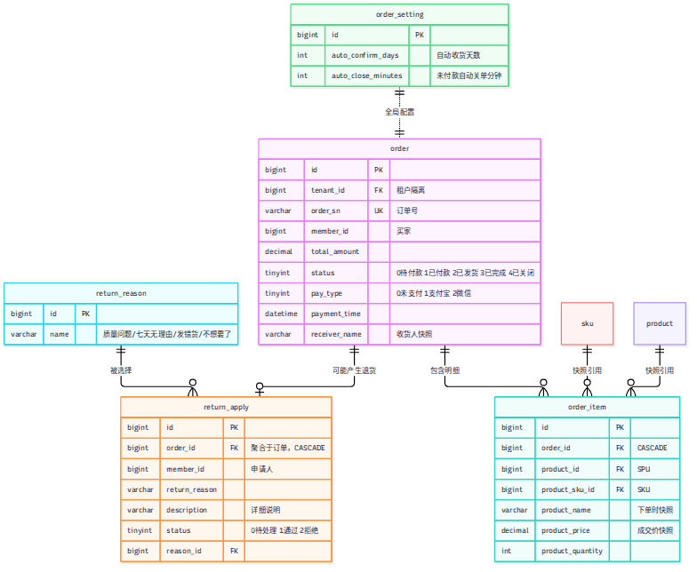
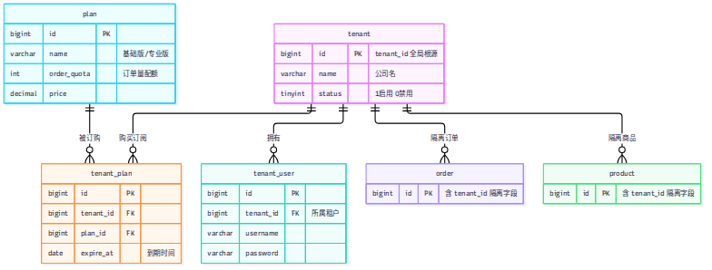

# 七七商城 ER 图

> 源码在 `docs/er/*.mmd`，重新出图：
> `npx --prefix /tmp/mmdc mmdc -p /tmp/mmdc/puppeteer.json -i docs/er/xxx.mmd -o docs/er-xxx.png -b white`

## 总览（全部 14 张表）



```mermaid
<!-- 见 docs/er/overview.mmd -->
```

## 商品模块（分类/类型/属性/SPU/SKU）



## 订单模块（订单/明细/退货/设置）



## 租户模块（租户/用户/套餐/订阅）


